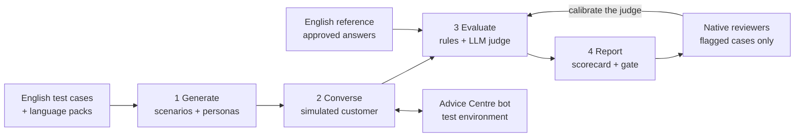

# PolyBot Agent: Case Solution

Fall 2026 Quest Student Program Case Competition · 2026-11-27

## Summary

PolyBot is an AI agent that plays a customer in French, Cantonese and Mandarin, talks to RBC's Advice Centre bots, and grades every answer against the English source of truth. It turns days of manual language testing into an automated run on every release.

- **What it tests:** content accuracy, context retention across turns, and user experience in each language.
- **What it produces:** a pass/fail scorecard per language, one parity score against English, and flagged transcripts for human review.
- **Why it wins:** it treats Cantonese and Mandarin as separate languages, calibrates its AI judge against native speakers, and uses no client data.

## Problem

Manual multilingual testing does not scale with the number of bots, languages and releases. Each new intent multiplies the work by every supported language.

- **Slow:** testers who speak each language must replay conversations by hand before each release.
- **Inconsistent:** two reviewers judge tone and correctness differently, and nothing is scored on a common scale.
- **Shallow:** time pressure means only the main paths get tested, so slang, typos, mixed-language input and long conversations are skipped.
- **Risky:** a wrong fee, rate or disclosure in one language is a client-trust and regulatory issue, not only a wording issue.

The case asks for three things to be verified in every language: content, context and user experience. PolyBot scores each one separately.

## Solution

PolyBot runs four steps in a loop: generate scenarios, hold the conversations, score them, and report.

1. **Scenario generator.** Takes the existing English test cases and intents (for example, "report a lost card") and writes native versions in each language. Each scenario gets several customer personas: formal, casual, typo-prone, and one who mixes English into the sentence.
2. **Conversation runner.** A simulated-customer agent holds a full multi-turn chat with the bot through its API or web UI. It runs the English version and every language version in parallel and records the transcripts.
3. **Evaluator.** Fast rule checks run first: reply language, amounts, dates, links, required disclosures, approved banking terms. Then an LLM judge compares each reply to the English reference answer and scores content, context and experience.
4. **Report and release gate.** A dashboard shows pass/fail per language and scenario, the parity score, and the worst transcripts. The run plugs into the release pipeline and blocks a release when a language falls below threshold.

Humans stay in the loop only where they add value: native speakers review the low-confidence and failed cases, and their verdicts feed back into the judge.

## Evaluation

Every conversation gets three scores from 0 to 1, one for each thing the case names.

| Dimension | Question it answers | Rule checks | LLM judge checks |
| --- | --- | --- | --- |
| Content | Is the answer factually the same as the English one? | Amounts, rates, dates, phone numbers and links match; required disclosure present | Meaning matches the reference; nothing added or left out |
| Context | Does the bot follow the conversation? | Correct intent detected; conversation ends in the expected state | Remembers earlier turns; handles follow-ups and corrections; asks sensible clarifying questions |
| Experience | Does it feel native? | Reply is in the customer's language and script; no English fallback; approved terms used | Tone and formality fit; no word-for-word translation; clear and polite |

The three scores combine into one number per conversation, and each language is then compared to English:

$$
\text{Score} = 0.5\,\text{Content} + 0.3\,\text{Context} + 0.2\,\text{Experience}
$$

$$
\text{Parity}_{L} = \dfrac{\overline{\text{Score}}_{L}}{\overline{\text{Score}}_{EN}}
$$

The weights are a proposed starting point that puts factual accuracy first; RBC would tune them. A parity of 1.0 means the language performs as well as English. A hard rule overrides the average: any content failure on a financial fact fails the scenario outright.

**Making the judge trustworthy.** Native speakers label a small set of transcripts per language. PolyBot measures how often the judge agrees with them, and a language is only auto-graded once agreement is high enough. Below that, its cases go to human review.

## Language specifics

Each language has its own failure modes, so PolyBot carries a language pack for each: a glossary, personas and targeted checks.

| Language | What goes wrong | What PolyBot checks |
| --- | --- | --- |
| French (Canada) | European French or literal translations; mixing *tu* and *vous*; English product names left in | Canadian banking terms such as CELI (TFSA) and REER (RRSP); consistent *vous*; French number and currency format (1 234,56 $) |
| Cantonese | Treated as Mandarin; replies in Simplified characters; bot fails on colloquial written Cantonese | Traditional characters; understands colloquial particles such as 嘅, 咗, 唔; Hong Kong terms such as 按揭 (mortgage) and 戶口 (account); handles English mixed in |
| Mandarin | Replies in the wrong script; Cantonese-specific wording leaks in | Simplified characters by default; Mandarin terms such as 房贷 (mortgage) and 账户 (account); option for Traditional-script Mandarin clients |

Cantonese and Mandarin share much of a writing system but are different spoken languages, so voice channels need separate speech tests for each. Adding a new language means adding a new pack and a small native-labelled calibration set, not rebuilding the tool.

## Architecture

PolyBot is a four-step pipeline around the bot under test, with the English reference as the anchor for every score.

Read it left to right: the evaluator is the core, and native reviewers' verdicts on flagged cases flow back to calibrate it.

A suggested stack for a competition prototype, all swappable for RBC-approved equivalents:

| Layer | Prototype choice | Purpose |
| --- | --- | --- |
| Orchestration | Python | Runs the pipeline and parallel conversations |
| Bot access | The bot's API, or Playwright for web chat | Sends customer turns and captures replies |
| Generation and judging | An RBC-approved LLM, with structured JSON output | Writes scenarios, plays the customer, scores replies with a reason |
| Rule checks | Language detection (lingua), script check (OpenCC), regex for amounts and dates, glossary lookup | Cheap, deterministic checks that run before the judge |
| Test runner | pytest in the CI pipeline | Turns scores into pass/fail and gates the release |
| Dashboard | Streamlit | Scorecard, parity per language, transcript viewer |

## Trust, risk and governance

PolyBot is built to pass a bank's risk review, because a testing tool that cannot be approved is never used.

| Risk | Control |
| --- | --- |
| Client data exposure | Synthetic customers and accounts only; runs against test environments; no production data |
| The AI judge is wrong | Rule checks for facts, where an LLM is not needed; judge calibrated against native speakers; low-confidence cases routed to humans |
| The judge shares the bot's blind spots | Judge uses a different model from the bot under test where possible, and always grades against the approved English reference |
| Results drift between runs | Fixed scenario sets, versioned prompts and a regression suite so scores are comparable release to release |
| No audit trail | Every transcript, score and judge rationale is stored for review |
| Model governance | Runs on RBC-approved models inside RBC's environment |

## Impact

PolyBot's value shows up in four measures, each tracked from the first pilot.

| Measure | Today (manual) | With PolyBot |
| --- | --- | --- |
| Time to test a release | Scales with scenarios × languages × tester minutes | One automated run; humans review only flagged cases |
| Coverage | Main paths only | Every intent, several personas each, in every language |
| Consistency | Varies by reviewer | One rubric and one scale for all languages |
| Defects reaching clients | Found after release | Caught at the release gate |

To put a number on it in the pitch, use this estimate with figures from the Advice Centre team:

$$
\text{Hours saved per release} = \dfrac{\text{scenarios} \times \text{languages} \times \text{manual minutes per test}}{60} - \text{review hours on flagged cases}
$$

Open question: the current manual testing hours per release and the number of intents per bot. Ask the case sponsor, or state your assumption on the slide.

## Roadmap

The proposed rollout starts with one bot and one language and widens only when each gate is met.

| Phase | Scope | Gate to move on |
| --- | --- | --- |
| 1. Proof of concept | One Advice Centre bot, French, 20 to 30 scenarios, rule checks plus judge | Judge agrees with native reviewers on the calibration set |
| 2. Pilot | Add Cantonese and Mandarin language packs; dashboard; side-by-side with manual testing for one release | PolyBot finds everything the manual testers found |
| 3. Release gate | Wired into the release pipeline; thresholds block releases; human review queue | One full release cycle with no missed language defect |
| 4. Scale | More bots, voice channels with speech tests, new languages as packs | Ongoing: parity tracked per release |

## Demo and judge questions

The demo is one scenario, "I lost my credit card", run live in English, French, Cantonese and Mandarin.

1. Show the English reference conversation and its expected outcome.
2. Start PolyBot. Three simulated customers chat with the bot at once, each in their own language.
3. Open the scorecard: English, Cantonese and Mandarin pass.
4. French fails. A planted error has the bot quote a different replacement-card timeline than English. PolyBot highlights the line, shows the judge's reason, and drops the French parity score.
5. Close on the dashboard: one screen that tells a release manager which languages are safe to ship.

**Questions to expect**

- **How do you know the AI judge is right?** Facts are checked by rules, not the LLM. The judge is calibrated against native speakers and uncertain cases go to humans.
- **Why not translate replies back to English and compare?** Back-translation hides exactly what the case cares about: tone, formality and unnatural phrasing vanish in the round trip.
- **What does it cost to run?** A run is a batch of LLM calls per scenario and language. Rule checks are free, and the judge only runs on replies that pass them.
- **How do you add Punjabi or Spanish?** Add a language pack (glossary, personas, checks) and a calibration set. The pipeline does not change.
- **Does it replace testers?** No. It removes the repetitive replay work so native speakers spend their time on the hard cases.
